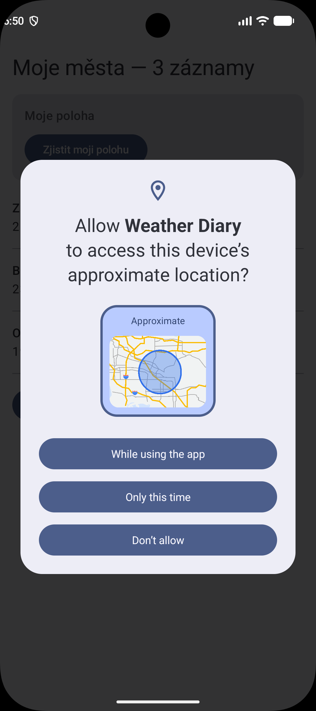
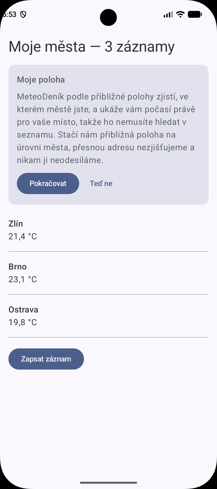
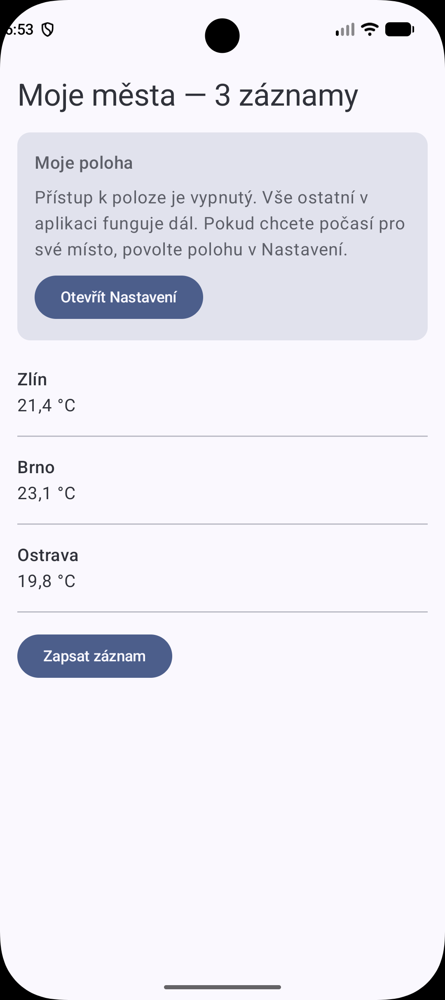
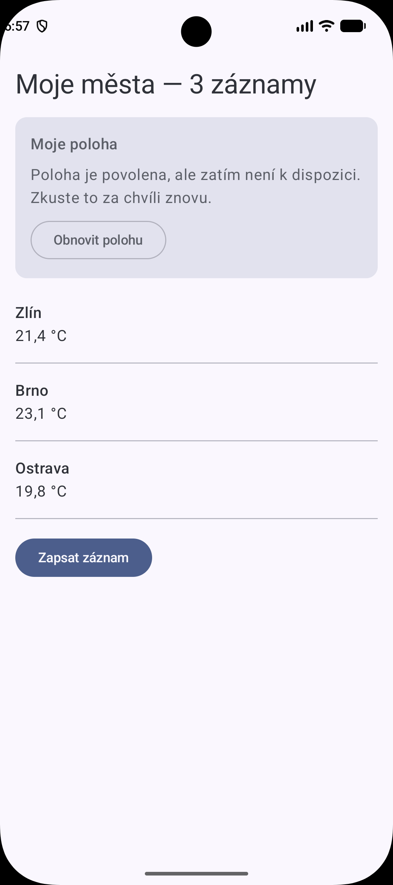

# Lekce 6 — oprávnění k poloze

## Čtyři stavy

| Stav | Co uživatel vidí | Screenshot |
|---|---|---|
| 1. Ještě nežádáno | Tlačítko „Zjistit moji polohu“ → systémový dialog |  |
| 2. Jednou zamítnuto | Po kliknutí vlastní vysvětlení, systémový dialog až po „Pokračovat“ |  |
| 3. Trvale zamítnuto | Text, že vše ostatní funguje, + tlačítko „Otevřít Nastavení“, žádný dialog |  |
| 4. Povoleno | Zeměpisná šířka a délka, nebo text, že poloha zatím není k dispozici |  |

## Proč se trvalé zamítnutí vyhodnocuje v callbacku

`shouldShowRequestPermissionRationale()` vrací `false` jak před první žádostí,
tak po trvalém zamítnutí. Při startu tedy oba stavy nelze rozlišit. Teprve hned
po zamítnutí v callbacku platí, že `false` znamená trvalé zamítnutí.

## Proč ACCESS_COARSE_LOCATION a ne ACCESS_FINE_LOCATION

Přibližná poloha je podle dokumentace Androidu přesná zhruba na 3 km²,
přesná poloha zhruba na 50 m. MeteoDeník potřebuje jen zjistit město kvůli
počasí, a to se na úrovni kilometrů nemění. Přesná poloha by nic nepřidala,
jen by od uživatele žádala citlivější údaj (princip minimálních oprávnění).
Uživatel navíc na Androidu 12+ může i tak zvolit jen přibližnou polohu.

Zdroj: https://developer.android.com/develop/sensors-and-location/location/permissions